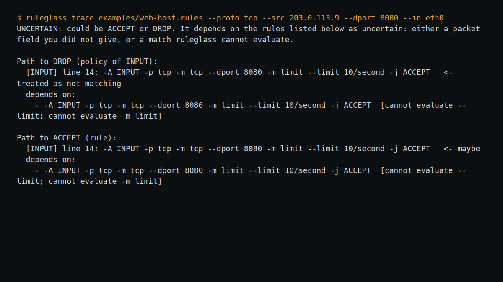

# ruleglass

Offline analysis and packet tracing for `iptables-save` / `ip6tables-save` output. It reads text you give it and never runs iptables.

```bash
sudo iptables-save > rules.v4                      # you run this yourself
ruleglass analyze rules.v4                          # shadowed rules, open sensitive ports, ACCEPT policies, ...
ruleglass trace rules.v4 --chain INPUT --proto tcp --src 203.0.113.9 --dport 22 --in eth0
ruleglass analyze rules.v4 --format sarif > ruleglass.sarif   # GitHub code scanning / SARIF viewers
ruleglass diff rules.old rules.new --fail-on opened            # what does the change newly allow or block?
```

Try it: `PYTHONPATH=src python -m ruleglass trace examples/web-host.rules --proto tcp --src 203.0.113.9 --dport 8080 --in eth0`

## What makes the answers trustworthy (or not)

A trace returns **ACCEPT**, **DROP**, **REJECT**, or **UNCERTAIN**. Matches that ruleglass cannot evaluate (`-m limit`, `-m recent`, `-m set`, ...) and packet fields you did not supply are treated as "maybe": both outcomes are followed, and if they differ you get `UNCERTAIN: could be ACCEPT or DROP`, listing exactly which rules and fields it depends on. A definite verdict means every branch agreed. Rulesets with endless uncertain branches stop after a step budget and say so.

## Diffing two rulesets

`ruleglass diff OLD NEW` answers the review question for a firewall change: *what does this newly allow, and what does it newly block?* It traces representative packets through both rulesets with the same three-valued tracer and reports every probe whose verdict differs, grouped by protocol, port range, source, destination and interface: `NEWLY ALLOWED`, `NEWLY BLOCKED`, `CHANGED` (for example DROP to REJECT) and `UNDETERMINED` (a verdict that depends on a match ruleglass cannot evaluate, such as `-m limit`, is never guessed).

```bash
ruleglass diff rules.old rules.new                       # INPUT chain, state NEW
ruleglass diff rules.old rules.new --chain FORWARD --format json
ruleglass diff rules.old rules.new --states all          # also probe ESTABLISHED, RELATED, INVALID
ruleglass diff rules.old rules.new --fail-on opened      # exit 1 only if something is newly allowed
```

Probes are not random. They are placed at the start of every cell that the two rulesets' own port ranges, networks and interface names create (each range's low end and the port after its high end, each network's first and one-past-last address, one address matching no network, each named interface, one interface that matches none), so within the fields a rule can express, a change cannot hide between probes. The test suite checks exactly this against a brute-force scan of a small domain for random ruleset pairs, and deliberately breaking each kind of probe makes that test fail. Ports 1 to 65535 are covered, not port 0.

## Static checks

| ID | Finding |
| --- | --- |
| RG001 | INPUT or FORWARD policy is ACCEPT |
| RG002 | Rule can never match (an earlier terminal rule provably covers it) |
| RG003 | Sensitive port (SSH, RDP, databases, ...) accepted from any source and interface |
| RG004 | Jump to an undefined chain |
| RG005 | User chain never jumped to |
| RG010 | NAT/mangle/raw rules exist but are not simulated |

RG002 makes no claim when rules use negation or unsupported matches.

## Limits

- **Validated against the real kernel only in a narrow slice**: 1,184 loopback TCP probes against random rulesets matched (see `tools/kernel_diff.py` and [docs/RESEARCH.md](docs/RESEARCH.md) for exactly what that covers and omits). Do not rely on a trace alone before changing a production firewall.
- Filter table only. NAT, mangle, raw are ignored (and flagged). nftables-native rulesets are not supported.
- `diff` compares filter-table behaviour for the packet fields the rulesets mention; it does not look at fields no rule mentions, does not model connection tracking beyond the `--states` you choose, and stops at 20,000 probes (and says so). It is a review aid, not proof that a change is safe.
- Connection state is whatever you pass with `--state`; ruleglass does not model connection tracking.
- The sensitive-port list is a judgement call.

## Roadmap

Not done yet, in rough order of value:

- nftables-native ruleset support (currently `iptables-save`/`ip6tables-save` text only).
- Connection-tracking modeling, so a trace does not have to trust whatever `--state` you pass.
- NAT, mangle and raw table analysis (currently filter-only; the other tables are flagged, not analysed).

## Development

`python -m unittest discover -s tests` (39 tests; mutating the negation logic makes them fail). Kernel differential test (Linux, root, iptables): `python3 tools/kernel_diff.py --rulesets 60 --seed 1` (re-run 2026-11-01 with `--rulesets 20 --seed 3`: 128 definite verdicts agreed with the kernel, 0 disagreed).

Not yet independently reviewed; the tests and documented limits describe what has been checked. MIT licence.

Designed and built by Maak — https://github.com/0xM44k

## Evidence



The image above is a capture of the command shown at the top of the image, run against the files in this repository on 2026-10-28. It is the tool's actual output, rendered in a terminal panel for legibility; no output lines were invented.
